# Computer Vision Brain Tumor Analysis

**Academic Computer Vision Project**  
**Author:** Vasileios Troupis

> **Educational use only:** This project is an academic image-processing exercise. It is not a medical diagnostic system and must not be used for clinical diagnosis or medical decision-making.

## 1. Objective

The objective of this project is to process a provided brain image and identify, isolate and analyze three predefined tumor regions using classical Computer Vision and image-processing techniques.

The workflow includes:

- RGB to grayscale conversion
- Manual thresholding
- Otsu thresholding
- Connected-component labeling
- Tumor-region isolation
- Region-area measurement
- Morphological dilation and erosion
- Morphological opening and closing
- Inner and outer boundary extraction
- Result visualization

## 2. Input Image and Preprocessing

The input image contains three visible target regions that are used as the regions of interest for the project.

The RGB image is converted to grayscale so that the following thresholding operations can be performed on a single intensity channel.

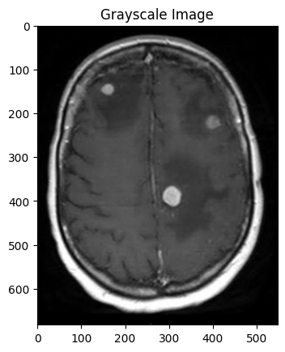

## 3. Thresholding

Two thresholding approaches are evaluated:

1. Manual thresholding
2. Otsu's automatic thresholding method

A manual threshold value of **50** is first evaluated.

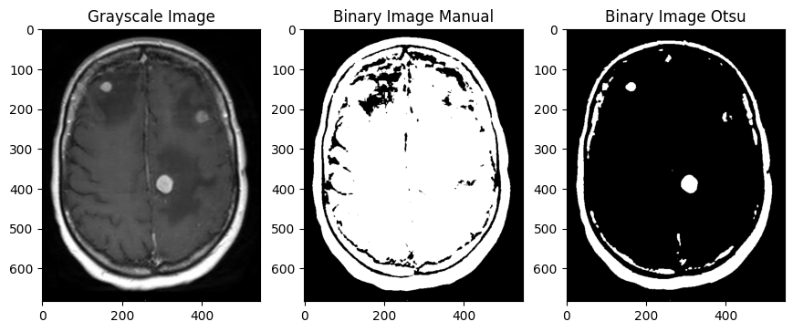

The manual threshold is then increased to **100** and compared again with Otsu's method.

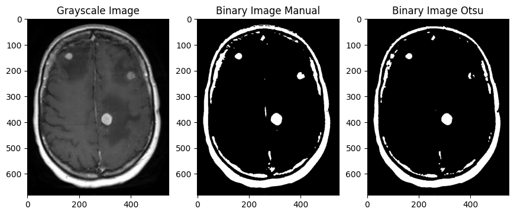

For this specific image, the manual threshold of **100** provides a clearer separation of the three target regions and is therefore used in the following processing steps.

## 4. Connected-Component Labeling

Connected-component labeling is applied to the binary image using connectivity equal to 1.

Each connected region receives a unique label. This makes it possible to inspect the detected components and select the three labels corresponding to the target tumor regions.

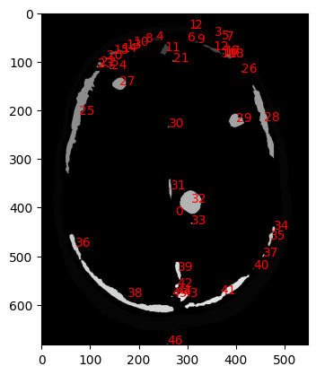

## 5. Tumor Region Extraction

The three selected connected components are combined into a single binary mask.

This mask contains only the target tumor regions and is used for the remaining measurements and morphological operations.

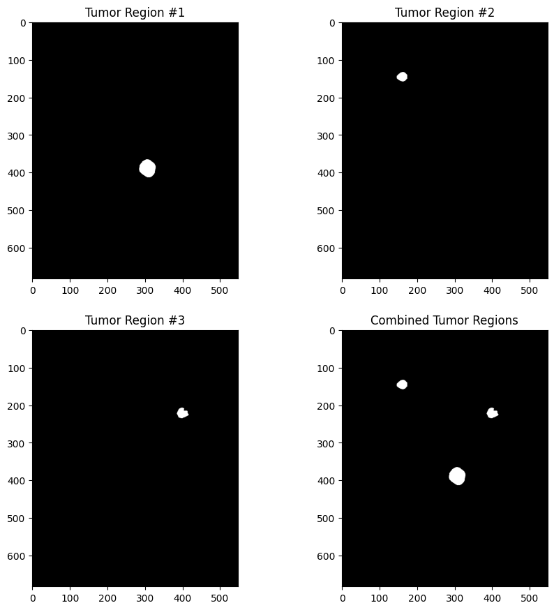

## 6. Region Area Measurement

The connected components of the combined tumor mask are labeled again and the area of each region is measured in pixels.

The calculated areas are:

- **Region 1:** 531 pixels
- **Region 2:** 592 pixels
- **Region 3:** 1586 pixels

The first two regions have similar areas, while the third region is substantially larger.

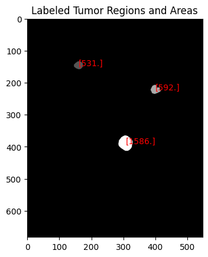

## 7. Morphological Processing

A diamond-shaped structuring element is used for morphological processing.

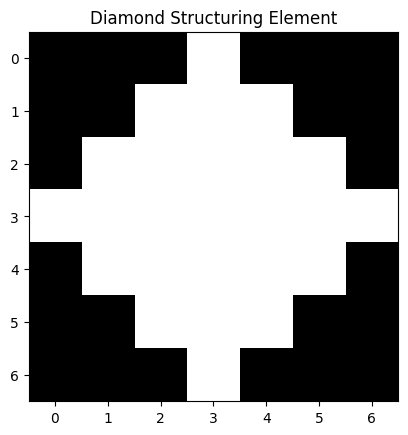

### 7.1 Dilation

Binary dilation expands the detected regions. It is also used as part of the outer-boundary extraction process.

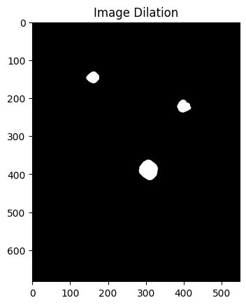

### 7.2 Erosion, Opening and Closing

The project also demonstrates:

- **Erosion:** shrinks the detected regions.
- **Opening:** erosion followed by dilation.
- **Closing:** dilation followed by erosion.

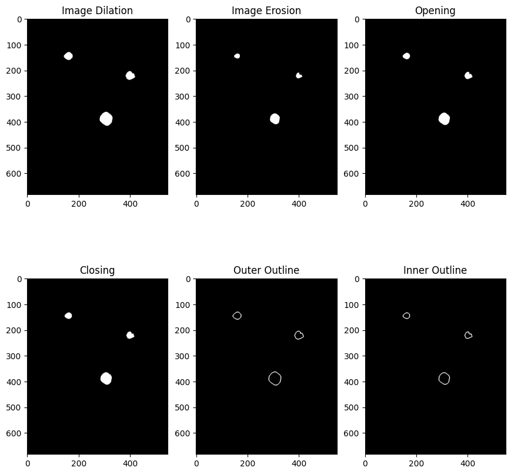

## 8. Boundary Extraction

The outer boundary is obtained by subtracting the original binary mask from its dilated version.

The inner boundary is obtained using the eroded version of the mask.

These operations provide two different representations of the boundaries of the detected regions.

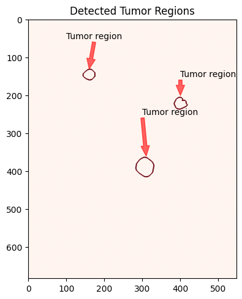

## 9. Final Visualization

The final processing stage combines the detected regions and their extracted boundaries for visual inspection.

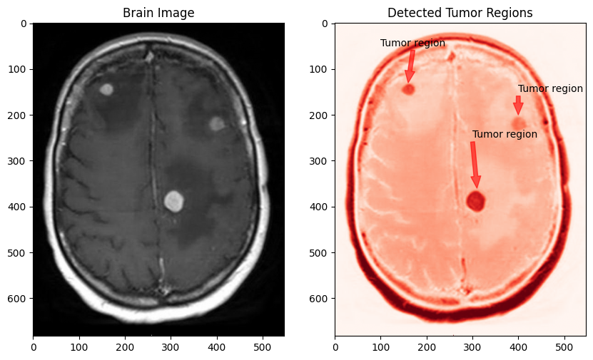

## 10. Conclusion

This project demonstrates a complete classical Computer Vision workflow for processing a predefined brain image.

Manual and automatic thresholding methods were compared, connected-component labeling was used to identify the target regions, region areas were measured, and several morphological operations were applied.

For the provided image, manual thresholding with a value of 100 produced a clearer separation of the three target regions than the tested Otsu result.

The final implementation also demonstrates dilation, erosion, opening, closing and inner/outer boundary extraction.

## Academic Context

This report documents a university Computer Vision project that has been reorganized and cleaned up for reproducibility and portfolio presentation while preserving the original project objective and methodology.
